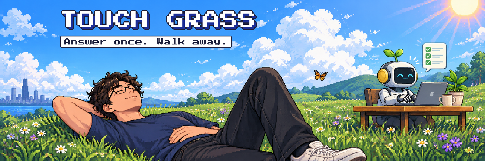
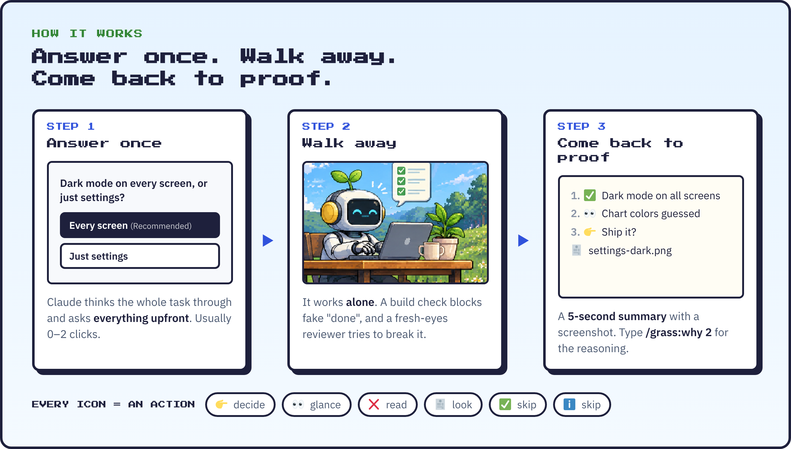
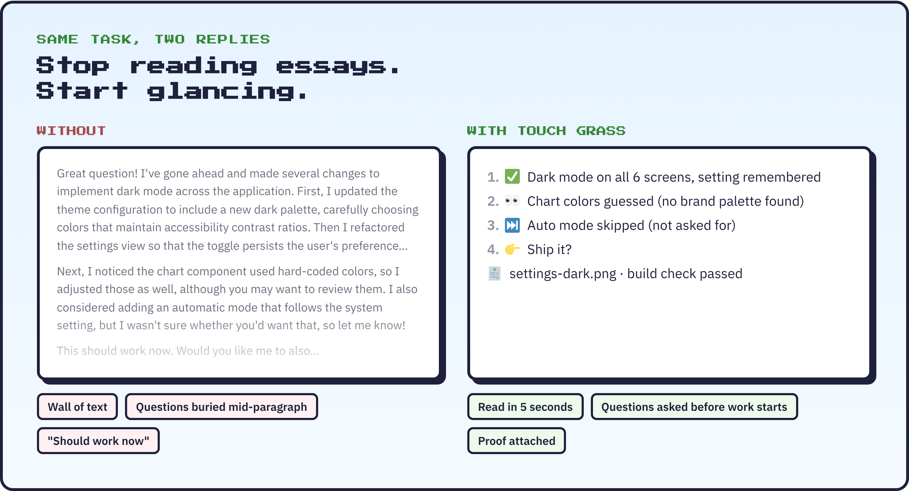

<p align="center">
  
</p>

<h3 align="center">Answer once. Walk away. Come back to proof.</h3>

<p align="center">
  A Claude Code plugin that stops you from babysitting your AI agent.<br>
  Claude asks everything upfront, works alone, proves it's done, and reports in icons instead of essays.
</p>

<p align="center">
  <a href="#install"></a>
  
  
</p>

---

You know the loop. You give Claude a task, then sit there. It asks a question halfway through. You answer. It writes you five paragraphs. You skim them, unsure whether it actually works. Repeat until your brain is mush.

**Touch Grass flips it.** You answer every question in one go at the start (usually with one or two clicks). Then you leave. Claude works alone, a build check stops it from claiming "done" when it isn't, and a second agent with fresh eyes tries to break the result. When you come back, you get a five-line summary and a screenshot.

<p align="center">
  
</p>

## Install

### The easy way: ask Claude

Paste this into Claude Code (terminal, VS Code, or the Claude desktop app):

```text
Install the Touch Grass plugin from github.com/takumicommits/touch-grass and set it up for me.
```

Claude adds it, then tells you to type **`/reload-plugins`** and **`/grass:setup`**. Setup checks your machine, asks you two quick yes/no questions, runs a self-test, and shows you around.

### Or type it yourself

```text
/plugin marketplace add takumicommits/touch-grass
/plugin install grass@touch-grass
/reload-plugins
/grass:setup
```

That's it. Same steps on Mac, Windows and Linux.

## What you get

| Type | What happens |
|---|---|
| **`/grass:start`** + your task | Claude thinks the whole task through, asks every question at once with one-click buttons (often none), then works alone until it's done or truly blocked |
| **`/grass:why 2`** | The reasoning behind item 2 of the last reply, in plain words. Only when you want it |
| **`/grass:wrap`** | Build check, fresh-eyes review, screenshot proof, commit, notes for next time. **`/grass:wrap quick`** skips the review |
| **`/grass:setup`** | Turn things on or off, change settings, or **`/grass:setup undo`** to reverse everything |

### And what happens on its own

- 🛑 **No fake "done."** If the project's build check fails, Claude gets sent back to fix it before it can stop.
- 🧠 **Memory between sessions.** Each project keeps a short `TASK.md` (goal, decisions, next step). Every new session reads it, so you never re-explain.
- 🔨 **Build checks set themselves up.** Code projects without one get asked to create it.
- 🌱 **Works without setup.** Install and go. Setup just makes the reply style stick harder and cuts permission prompts.

## Every icon is an action

Replies are numbered lists where each icon tells you what to do with that line, so you can read a whole report in five seconds.

| Icon | Means | You |
|:-:|---|---|
| 👉 | Needs your decision | Click a button |
| 👀 | Guessed or untested | Glance at it |
| ❌ | Broken or blocked | Read it |
| 🧾 | Proof | Look at it |
| ✅ | Done and verified | Skip |
| ℹ️ | Note or tradeoff | Skip |
| ⏭ | Skipped on purpose | Skip |

<p align="center">
  
</p>

## Before you install

**Requirements**
- Claude Code with plugin support
- `git` and Python 3.8+. On Windows that means [Git for Windows](https://git-scm.com) (Claude Code uses its Git Bash) and Python. `/grass:setup` checks both and offers to install Python for you.

**What it changes**
- Nothing until you run `/grass:setup`, and even then only two things in your Claude settings: the reply style, and (if you say yes) pre-approval for routine commands like `git status`, `git commit` and builds. Push, delete and restore always still ask.
- Every change is backed up first. **`/grass:setup undo`** puts it all back.

**Privacy**
- Everything runs on your computer. No accounts, no servers, no tracking.

## FAQ

<details>
<summary><b>Does it cost more tokens?</b></summary>

Usually fewer. Short replies mean fewer output tokens, which are the expensive kind. The extras are small: a few hundred tokens of command descriptions per session, and a review on <code>/grass:wrap</code> that runs on a cheaper model, only when more than two files changed.
</details>

<details>
<summary><b>Will it fight my own CLAUDE.md rules?</b></summary>

No. Your rules win. If your CLAUDE.md asks for something in every reply, Touch Grass keeps it.
</details>

<details>
<summary><b>What's the build check?</b></summary>

A tiny script at <code>.claude/check.sh</code> in each code project, holding the fastest command that proves the project still builds (like <code>npm run build</code> or <code>swift build</code>). Claude creates it for you the first time. When it fails, Claude can't call the task done.
</details>

<details>
<summary><b>Can I skip the hooks in some folders?</b></summary>

Yes, for example folders where scheduled jobs run: <b><code>/grass:setup exempt ~/some/folder</code></b>. You can also rename the notes file: <b><code>/grass:setup notes STATUS.md</code></b>.
</details>

<details>
<summary><b>How do I uninstall?</b></summary>

Run <b><code>/grass:setup undo</code></b>, then <b><code>/plugin uninstall grass@touch-grass</code></b>.
</details>

## For Claude: installing this for a user

If a user asks you to install Touch Grass:

1. Run `claude plugin marketplace add takumicommits/touch-grass`, then `claude plugin install grass@touch-grass`. If the `claude` command isn't available in your shell, give the user the four commands under "Or type it yourself" instead, and stop.
2. Tell the user to type **`/reload-plugins`**, then **`/grass:setup`**. Setup runs from inside the plugin and handles the rest.

## Contributing

Issues and pull requests are welcome. Run the self-test before sending a change:

```bash
bash tests/selftest.sh
claude plugin validate .
```

## Credits

- Banner and icon art by [takumicommits](https://github.com/takumicommits).
- Pixel font: [Press Start 2P](https://fonts.google.com/specimen/Press+Start+2P) by CodeMan38 (SIL Open Font License). Text font in the explainers: [IBM Plex Sans](https://github.com/IBM/plex) (SIL Open Font License).
- Icons in the explainer images: [Twemoji](https://github.com/jdecked/twemoji) (CC-BY 4.0).
- Built with Claude Code. Not affiliated with or endorsed by Anthropic.

## License

[MIT](LICENSE)
